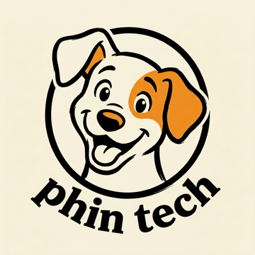
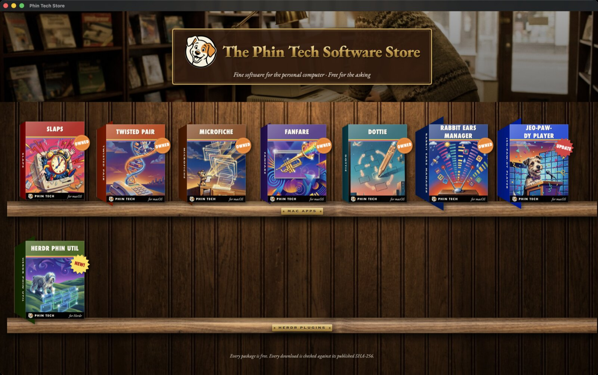
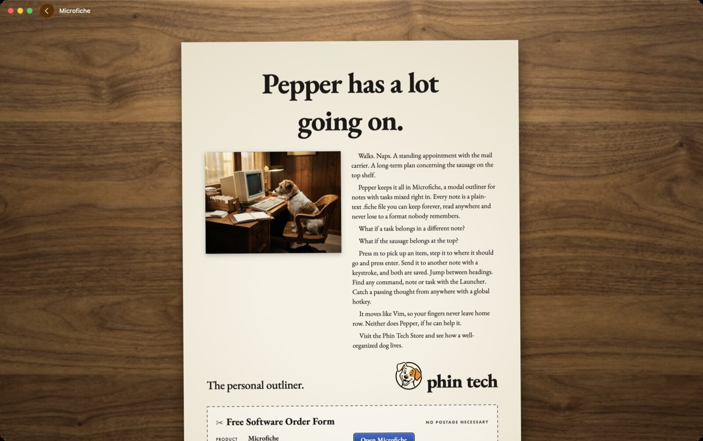

<p align="center"></p>

# Phin Tech Store

Fine software for the personal computer. A Mac app that puts every app from
[apps.phin.tech](https://apps.phin.tech) on wooden shelves, as boxed software in a
1990s shop, and gives each one a magazine ad of its own.



Click a box to read its ad. At the bottom is a clip-out order form: **Install**
downloads the release, checks it against its published SHA-256, and puts the app in
Applications, sending any older copy to the Trash. Apps you have are marked **Owned**,
and ones with a newer release are marked **Update**. **Store ▸ Update All** (⇧⌘U)
updates them all. Herdr plugins download to your Downloads folder, with their install
command one click away.



The shelves come from `https://apps.phin.tech/apps.json` each time the store opens, so a
new release appears without updating the store. The last catalog is kept so the store
opens offline.

## Install

Download the zip from the [latest release](https://github.com/phin-tech/phin-tech-store/releases/latest)
or from [apps.phin.tech](https://apps.phin.tech), unzip it and drag **Phin Tech Store**
into Applications. It updates itself. macOS 14 Sonoma or later.

## Develop

```sh
just build     # needs Xcode and xcodegen
just test
just run
just install   # a development build in /Applications
```

See [DEVELOPMENT.md](DEVELOPMENT.md).

### Adding an app

An app published to apps.phin.tech shows up on its own, with a plain ad made from its
description. To give it a real ad:

1. Write its copy in `App/Resources/Ads.json`, keyed by its apps.json id: a layout
   (`classic`, `photo`, `columns` or `product`), a box colour, a headline, sections, a
   tagline and fine print.
2. Add a `<id>-hero` and a `<id>-box` prompt to `art/prompts.json`, then run
   `tools/genart.py <id>-hero <id>-box`. It renders them with an image model on
   OpenRouter (the key is read from 1Password) and writes JPEGs to
   `App/Resources/Art`.

Fonts: EB Garamond (SIL Open Font License, `App/Resources/Fonts/OFL.txt`).
